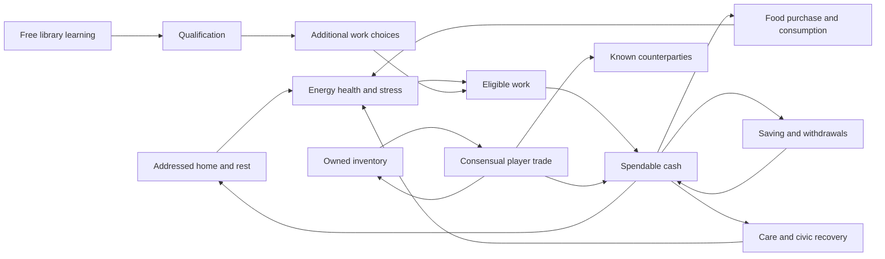

# Dhaniverse player choices and consequences

**5 November 2026. Accepted gameplay direction, with proposed activities and implementation requirements.**

Dhaniverse is a shared economic life simulation. Players decide how to live, earn, learn, recover and build relationships in a persistent town. The first playable neighborhood must demonstrate that freedom. A successful work → food → bank walkthrough verifies the plumbing; it does not establish that the game is enjoyable or supports different lives.

The founder has accepted this direction: **give players more meaningful choices, connect the consequences to other opportunities, and keep the game playable when they choose a different order or suffer a setback.** The tutorial introduces the world. After that, personal goals and current circumstances guide play.

**Founder clarification:** Minigames, tasks, grind and progression are central to
why people play. Financial learning emerges indirectly as they choose how to use
earned resources and pursue their lives. Choice design must connect enjoyable
activities to consequences; it cannot replace those activities with menus and
waiting. Repeated play should offer mastery, variety and progress toward chosen
goals. Minigame designs and their reward rules still need specification and testing.

The [lore and repeatable-play proposal](16_Lore_And_Repeatable_Play.md) connects
activities, personal ambitions and the shared town beyond initial upgrades.

The full 24-system vision and MANAGE → EARN → SPEND → PLAN remain intact. [Canonical rules](11_Canonical_Game_Rules.md) and their system owners still govern amounts, thresholds, clocks and ownership. Specific activities, new recovery bridges and balance changes below remain proposals until their rule decisions and playtests are complete. This chapter governs how the next playable milestone demonstrates agency; it does not silently replace those rules. Research and source limits explain the external evidence.

## What a meaningful choice must do

A choice needs a reason to exist in the player's present circumstances. Working earns immediately but occupies time that could go toward education. Saving preserves money for later but can leave less immediately available for essentials. Better housing offers different recovery and capacity alongside a different rent and commute. The best option can change with the player's condition, obligations and relationships.

For every major interaction, define:

1. What the player wants and what they can observe before acting.
2. The available alternatives, including declining or postponing where appropriate.
3. The immediate cost, benefit and commitment.
4. Which later opportunities or difficulties change, and why.
5. How the player recognizes that change in the world or their records.
6. What remains possible if the action becomes unavailable or goes badly.

More options alone are insufficient. Two food items with identical effects and different prices offer little reason to choose the expensive one. A decorative errand that always leads back to the same mandatory job adds distance rather than agency. Small expressive choices can simply support belonging; choosing where to sit need not change a credit score.

Major economic choices should connect across systems. Buying food changes cash and usable energy, which changes the next feasible activity. A cosmetic planter can matter through personal attachment without gaining an invented economic bonus. Preserve space for discovery, conversation and enjoyment between decisions.

## Different priorities in the same town

The existing [progression pathways](03_Player_Progression.md#player-pathways) describe aggressive growth, steady stability and community. Treat these as possible strategies, not character classes chosen at registration. A player can change priorities as their life changes.

| Priority | Early choices | Later connections | What makes the path viable |
|---|---|---|---|
| Stability | Retain an essentials buffer, maintain condition, learn a reliable work route | Less exposure to unpaid obligations, a dependable home and gradual upgrades | Everyday costs must permit an attainable routine; survival cannot require maximum attendance |
| Qualification | Use the free library, then evaluate paid education and its commitments | Additional job eligibility, savings toward school, later specialization | The library must lead to an actually available qualified role; study must have a readable opportunity cost |
| Enterprise | Compare actual market offers, sell owned goods, observe unmet demand | Inventory planning, capital, permits, a business frontage and eventually employment | Selling must use real stock and buyers; the economy cannot fabricate sales to validate the path |
| Community | Meet neighbors, trade by consent, work near others | Repeated counterparties, earned reputation, later lending and SHG commitments | Playing alone remains viable; another player's refusal or absence cannot block essential recovery |

The first build does not need full businesses, loans and SHGs. It needs credible beginnings of distinct paths. Trading is initially supplementary income or exchange; do not promise a self-sustaining merchant career before its supply and margin rules exist.

Education can remain a prerequisite for specific jobs without becoming a compulsory quest that every player must follow immediately. Higher pay does not erase the value of stability, preferred work, relationships or ownership goals. Check actual outcomes: an education path that dominates every alternative is compulsory in practice, even if its button is optional.

## The first neighborhood choice network

Build opportunities from current state, not from a single next-task pointer. The diagram shows relationships, not a required itinerary. Work and study remain subject to eligibility and activity compatibility.

Cash enables paid housing and treatment under their rules; a lack of cash must not eliminate emergency access. Shared stock, market pricing and finite housing constrain the network. A route drawn here is a design responsibility, not proof that its costs or eligibility are already viable.

| Decision | Immediate consequence | Meaningful connections | Alternative or recovery |
|---|---|---|---|
| Work now or visit the library first | Earn now or spend eligible time learning | Literacy opens documented shop/workshop roles; wages support food and future obligations | Entry work remains available when eligible; education is not required to dismiss onboarding |
| Choose between eligible workplaces | Different quoted pay, commute and advancement | Repeated workplace shifts support the existing raise rules; qualifications widen access | Another reachable role or recovery destination when a job is unavailable |
| Finish or leave a shift early | Full settlement or canonical proportional partial pay | Remaining session time becomes available for another compatible activity | Explain the earned amount; leaving or disconnecting must not corrupt the shift |
| Buy a cheaper food or a different meal | Different price and documented resource effects | Remaining cash, energy and stress alter work or recovery plans | Another stocked food, seller or eligible support channel; no automatic substitute purchase |
| Buy from the market or another player | Different offer, stock and counterparty | Shared supply, personal inventory and repeated relationships | Either party can decline; refresh unavailable offers without taking coins |
| Eat an item or keep it | Recovery now or retained carried stock | Expiry, future need and possible trade | Show actual expiry and effects; no fictional stock produced by visual props |
| Retain cash or deposit some | Change the location of money, not total wealth | Upcoming rent, purchases and withdrawal access affect liquidity | Withdrawal under account rules; clearly distinguish accessible savings from locked deposits |
| Rest or undertake another compatible activity | Recover at the documented rate or commit time elsewhere | Condition changes later eligibility and recovery cost | Explain actual recovery progress and gates; do not promise instant recovery |
| Save toward education or housing | Different use of limited funds | Qualification versus comfort, storage, commute and ongoing cost | Goals can be changed without resetting either history |
| Apply for eligible support or postpone | Verified benefit or continued exposure to costs | Ration-card purchasing, rent affordability and return to work | Explain eligibility and next review; changing goals does not reset benefits or mint another grant |
| Choose a different home when available | New terms, address and daily routes | Recovery, capacity, neighbors and obligations | Keep the existing lease until an authorized transition; handle full occupancy explicitly |
| Explore or talk instead of following a suggestion | Discover a place or relationship; real clocks still apply | Learn routes, compare opportunities and find a reason to return | No quest-order penalty or fabricated reputation reward for ordinary conversation |

Some rows require later systems. They identify what those systems must connect to, rather than claiming they are already playable. The first implementation includes a narrow, working subset and marks unavailable services honestly.

## Activities that make these choices worth playing

### Work and shared workplaces

Prototype the [market activity proposal](13_World_And_Play_Design.md#market-shift-activity-proposal): prepare a stall, handle readable orders and notice committed stock changes. Objects need usable counters, clear handover points and understandable employer ownership. Another player buying at the counter gives the workplace a connection to the town.

The existing attendance rules earn the quoted wage. Do not add a clicking quota, new wage multiplier or unpaid mandatory minigame. Rearranging a crate does not manufacture food or pay an extra wage. If production tasks are adopted later, define their inputs, outputs, authority and settlement separately.

The full 30-minute normal shift must be tested. Optional episodes, local conversation and financial planning may make it enjoyable, but that is not established. Record idle time and voluntary engagement. If the normal duration fails, propose a clock or work-rule change explicitly rather than hiding a shorter timer in code. The five-minute tutorial remains its documented exception.

### Learning and observation

The library supplies an early alternative to immediate earning. A candidate learning interaction asks the player to compare a small set of real offers and explain their preference, then shows the actual consequences. Avoid an unexplained multiple-choice quiz disconnected from their life. Course completion, cost and duration still follow education rules; an assessment requirement or new reward would need an explicit rule decision.

Learning should improve the player's ability to reason about unfamiliar situations. Wealth alone does not prove financial understanding. Later educational evaluation should test decisions outside the exact practiced example.

### Home and belonging

A home is a persistent physical address, a bed and a set of permissions and obligations. The shared court supports seeing familiar neighbors. Later furniture and storage alter usable space within existing rules. Housing quality, commute and recurring cost should create a real choice rather than a straight ladder of identical boxes.

Daily life also needs room for taking a different path, meeting someone or recognizing a garden without receiving a task reward. These moments help the world become familiar. Preserve its contemporary river-and-rail history and the approved architecture and foliage language.

## Consequences with a way forward

The promise is continued play with understandable consequences. It is not that every action succeeds, every expense is refunded or every path is equally profitable. Debt, missed work and eviction can remain consequential. Essential recovery must be reachable without requiring money, energy, health or another player that the affected character cannot obtain.

Distinguish four outcomes. A permitted decision commits a valid state transition. An unavailable action explains its gate and leaves state unchanged. A setback commits the documented consequence and exposes feasible next steps. A transport failure resumes or settles from authoritative state without duplicating an action. Never treat all four as a generic failure popup or restart onboarding.

| Situation to test | Required continuation | Current rule or unresolved bridge |
|---|---|---|
| Player spends available cash and then lacks work energy | Show food, eligible aid and recovery options with actual requirements | Tier 0 has no idle recovery; do not assume an unpaid bed solves the state. Trace the complete energy/cash path |
| Critical health, illness and zero cash coincide | Emergency access, necessary medicine and eventual work eligibility remain achievable | Emergency treatment on account is canonical; medication affordability and combined eligibility still require a complete audit |
| High stress blocks work | Reach the library/refuge or another eligible relief channel | Verify travel cost, amount of relief and repeated-use rules against the work threshold |
| Rent is missed or eviction occurs | Show the obligation, grace or eviction result, possessions and next housing/recovery options | Preserve 12-hour grace and documented penalties; Tier 0 plus welfare needs an end-to-end feasibility check |
| All starter rooms are occupied | Give an honest capacity outcome and a defined onboarding policy | Twelve starter rooms are finite. Queueing, more authored units or another arrival arrangement is an unresolved production decision |
| An offer is gone or two players buy the last item | The winner pays once; the other retains funds and sees current alternatives | Price floors do not prove an immediately purchasable shelf item or affordable substitute exists |
| A player declines trade or no other player is online | Independent work, food and recovery remain usable | Social play offers opportunity, not mandatory consent for survival |
| Player leaves or disconnects during an activity | Apply its own documented interruption rule and show the result on return | Work settles partial pay on disconnect; treatment and other server timers have different rules |
| Long absence creates obligations | Present a readable account of changes and an actionable recovery route | Existing offline clocks remain; casual-return viability needs testing before additional penalties ship |
| A course is missed or a goal is changed | Apply the course's own rule and preserve unrelated progress | Goal preferences cannot erase enrollment, debt, dropout history or existing qualification |

For each reachable hardship state, trace a sequence back to a useful activity with explicit cost, eligibility, travel and elapsed time. A map path or a button named welfare is not enough. If the chain ends with 'buy food to earn money to buy food', record a blocked design case. Do not ship the added pressure before its bridge exists.

Recovery also needs economic accounting. Aid is an explicit source with eligibility and cadence; trade is a transfer; buying is a source/sink or transfer according to the seller; returning to onboarding cannot mint a second starter grant. Test repeated aid, interrupted treatment and bankruptcy loops for unintended profitable resets.

## Connections as the wider game grows

Later systems should deepen existing decisions rather than introduce another isolated checklist. Their documented prerequisites still apply.

| Connection | New decision it creates | Required consistency |
|---|---|---|
| Clothing → laundry/repair → work and reputation | Maintain an owned item, replace it or accept its documented condition effects | Wear and maintenance have authoritative state; cosmetic skins cannot buy economic advantages |
| Illness → care → medication → insurance claim → cash flow | Treat, finance necessary care and evaluate future protection | Preserve emergency access and activation rules; treatment and claim filing remain distinct actions |
| Qualification → employment → savings → business permit and capital | Continue dependable employment or commit to ownership | Eligibility opens an option; it does not force entrepreneurship or invent customer demand |
| Business location → stock → price → actual customers → staffing | Balance a frontage's cost, margin, availability and opening coverage | Visual footfall is not revenue; purchases and real agreed wages determine the ledger |
| Housing → storage → inventory → trading | Pay for capacity and comfort or keep a leaner household | Carried slots, stored item quantities and furniture floor cells remain separate budgets |
| Transport/device → commute and service access → spending | Pay for saved effort or retain cash and travel physically | Remote access must correspond to implemented services and documented conditions |
| Trust → player lending/SHG → commitments → recovery | Accept collective support and responsibilities or remain independent | Consent, schedules, privacy and defaults are explicit; another player's departure cannot block essential care |

Some connections expose gaps rather than finished rules. In particular, repeat direct trades grant reputation in the existing reference. Two accounts could exchange items back and forth to accelerate access without a meaningful economic relationship. Audit empty trades, circular trades, collusive lending and repeated event contributions before exposing reputation rewards to the pilot. Any cooldown, diminishing reward or eligibility change needs its own explicit rule decision; disabling legitimate trade by arbitrary quest order is not a solution.

## Events should change opportunities

Use events to alter established conditions through their documented owners. A food supply disturbance enters the existing supply/demand engine. Its effect may change which food, seller or spending plan is attractive. Show the cause in stock notices and price explanations; do not secretly write a quest-specific price or override the tick cap.

For a later festival, define attendance, food demand, social opportunities and any employment offers against finite budgets and real transaction rules. Players who ignore the festival still have their own work and recovery routes. A setback can open a response such as finding another seller or using eligible support, without obligating a scripted 'fix the shortage' quest.

This is our adaptation of a documented pattern in Guild Wars 2: shared events alter an area and can lead into further activity after different outcomes. It does not establish that Dhaniverse needs combat events or identical rewards. [ArenaNet dynamic events](https://www.guildwars2.com/en-gb/the-game/dynamic-events/).

## Town layout follows the decisions

Retain DV-01 arrival, DV-02 bank, DV-03 market, DV-04 Common Table and DV-05 housing. The library and minimal care/civic recovery branch should be reachable early. Preserve released addresses and occupied-unit identity. Additional qualified work must have a real premises and a reason to choose it.

Organize a connected network: housing court to market; market to bank and Common Table; a loop toward the library and qualified workplace; clear care and civic approaches. Routes can cross so repeated trips bring familiar encounters. Keep service entrances, public frontages and receiving yards distinct. A longer garden route may be attractive to explore without receiving an invented health bonus.

Measure actual step-counter costs and travel time at full and impaired condition. A higher-pay role farther away only creates a choice if travel, qualification and time make both options credible. Do not tune streets to make one intended itinerary artificially unavoidable.

DV-06/07/08 should gain interactions when their services matter: grocery reliability/bulk purchasing, clothing maintenance and employment access, device repair and saved trips. Finished exterior meshes do not validate these mechanics. Prioritize counters, rooms, doors, beds, inventory presentation and usable thresholds before another run of generic service shells.

## Runtime requirements for freedom of order

Author bounded commands for work, purchases, consumption, banking, learning, leases and trade. Each checks the relevant current state, access, activity compatibility and trusted clock. A tutorial completion flag must not become permission for an unrelated world action. Actual prerequisites remain: registered identity for banking, qualifications for specific roles, ownership to sell goods and eligibility for benefits.

Do not implement an unrestricted universal action engine. Use the existing pure Rust transitions and durable command boundary, adding shared stock, units and timed contracts as needed. Goals and tutorial hints are a presentation layer over that authority. They cannot own wages, prices, leases or progression.

| State needed | Why it belongs in the model |
|---|---|
| Player condition, balances and inventory | Determine feasible actions without relying on a previous screen |
| Qualification and explicit enrollment | Separate learned progress from a chosen goal or UI suggestion |
| Active activity and interruption policy | Enforce incompatible actions and settle reconnects correctly |
| Stable unit, lease and obligation | Keep address, recovery access and rent true across cosmetic rebuilds |
| Stock, offers and accepted terms | Prevent sold-out trades, stale quotes and fabricated supply |
| Counterparty consent and permitted reputation effects | Keep relationships voluntary and changes tied to documented events |
| Durable events, receipts and revisions | Explain history, retry safely and recompute current opportunities |

The UI should show quoted cost, duration, effects and relevant commitments before acceptance. Afterward it shows what actually changed. When a stale offer or revision is rejected, refresh authoritative state and allow a new decision; never retry against a changed price without consent. Suggestions use available information and do not grant a free phone or remote-service access to a starter character.

The current SQLite executable provides a local persistence foundation, not these complete systems. Network transport, Godot integration, shared stock, leases, activity evidence and education remain implementation work. PostgreSQL remains the production authority described in [runtime architecture](../specs/systems/Runtime_Architecture.md).

## Revised build sequence

Each stage leaves a reviewable result. Placeholder interactions can prove design while art proceeds through its existing gates. Labels must distinguish scenery, prototypes and working services.

1. **Settle the first choices.** Specify work activity, activity compatibility, rest/drain, identity registration, quotes and the recovery cases above. Compare food and daily budgets for dominance and solvency using canonical values. Record unresolved cases rather than quietly adjusting constants.
2. **Build a connected blockout.** Retained anchors, actual addressed room/bed, usable market, library, second workplace reservation and care/civic routes. Walk those connections with the real controller and condition states.
3. **Connect authoritative everyday actions.** Work and settlement, owned food/consumption, cash/savings, lease/rest, essential recovery and reconnect. Actions can occur in any permitted order. Keep the linear walkthrough as one verification scenario.
4. **Add the first outward alternatives.** Free literacy with a working qualified role, shared stock/prices and one consent-based player trade method. Begin with enough real housing capacity for the test cohort. Real-time visibility/chat follows the chosen pilot scope; multiple clients must already share economic truth.
5. **Test different lives.** Recruit players with different priorities, include an empty-world session, observe their chosen goals and run hardship/interruption cases. Review the full normal work duration and casual daily affordability before scaling content.
6. **Expand through demonstrated connections.** Paid education, care/insurance, maintenance, wider housing, businesses, transport, SHGs and lending enter when they add tested choices and valid recovery. Their 24-system destination remains intact.

## Acceptance and evidence

The defining test is whether two players can begin in the same town, choose different priorities, affect shared opportunities and end with different self-chosen next goals. A rehearsed demonstration is insufficient.

| Review | Evidence required |
|---|---|
| Order independence | Library before first wages; purchase before job; early bank visit with registration; withdrawal after deposit; exploration and return; goal changes without reset |
| Different strategies | Observe immediate earning, qualification-first and stability-focused sessions without a compulsory next-task gate |
| Genuine education choice | Literacy leads to an implemented role; declining study still permits a viable eligible routine |
| Consequence visibility | Players can explain their last trade-off, the actual result and what they intend to do next |
| Shared economy | Another purchase changes committed stock/market state; simultaneous last-item attempts cannot spend twice or oversell |
| Interrupted play | Disconnect, reload and repeated commands preserve identity and settle the applicable activity once |
| Recovery | Complete zero-cash, blocked-work, illness, eviction and unavailable-housing cases with measured cost and time, or explicitly block the affected release |
| Enjoyment | Record voluntary activity, idle time and where people lose interest; essential timers are not evidence of engagement |
| Continued interest | Observe voluntary return with cohort size/build/exposure reported; no retention or educational guarantee follows from the proposal |

Use targeted domain and transaction tests for invariants, then controlled simulations for affordability and recovery, and human playtests for understanding and enjoyment. Generated action sequences should cover different valid orders and interruptions; they complement, rather than replace, authored boundary cases. There are no new passing test results claimed by this chapter.

The motivation research supports investigating autonomy, mastery and connection, while the agency literature asks whether intended actions match what the game actually permits. Our design inference is to test those experiences directly rather than use task completion as their proxy. [Motivation review](https://selfdeterminationtheory.org/SDT/documents/2010_PrzybylskiRigbyRyan_ROGP.pdf), [Agency Reconsidered](https://eis.ucsc.edu/papers/nwf-C7-digra09-agency.pdf).

## Immediate design work

Use the [first neighborhood interaction briefs](15_Neighborhood_Interaction_Briefs.md) for the market shift, library visit, food comparison, savings decision and first player trade. Resolve their named rule gaps and audit the hardship cases before adding more penalties. Then implement the connected neighborhood with enough alternatives to assess actual freedom, while improving its terrain and architectural cohesion.

Related authority: [core gameplay](02_Core_Gameplay.md), [progression](03_Player_Progression.md), [multiplayer](06_Multiplayer_Design.md), [development scope](12_Product_Direction.md), [world and play design](13_World_And_Play_Design.md), [canonical rules](11_Canonical_Game_Rules.md), full-game roadmap.
