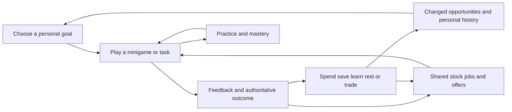

# Dhaniverse lore and repeatable play

**5 November 2026. Proposed narrative and gameplay design.**

Dhaniverse needs a recognizable place, enjoyable activities and connected reasons to play after initial survival and upgrades. The target is open-ended repeatable play with persistent progress. Finite quests, randomized instructions and increasing prices cannot guarantee unlimited enjoyment.

This proposal develops the existing river-and-rail history, all 24 systems and the founder's emphasis on minigames, tasks and grind. New arrival-story details, characters, mastery goals and community projects are proposals. [Canonical rules](11_Canonical_Game_Rules.md) retain clocks, pay, resources, qualifications and ownership. No new reward formula or implemented system is introduced here.

## Lore that explains the town

The town began where ferries crossed the river and traders exchanged goods. The landing became a market. Craftspeople established workshops behind it, and workers built homes around shared courts. The bank, food counters and civic offices grew because people needed to trade, recover, settle accounts and trust each other. Rail later brought more people and commerce to the east. This history comes from [city art direction](10_City_Art_Direction.md).

The proposed present-day story is a town still negotiating that growth. Established residents know its routines; newcomers see different opportunities. A repairer wants a dependable workshop, a stallholder wants regular customers, a renter wants a secure home, and someone studying wants better work. Their ambitions cooperate or compete over time, space, stock and money. No profession or wealth tier defines a successful life.

The player arrives to build a life here. A proposed municipal welcome desk explains the existing starter grant and three-day room period, introduces the actual room address and points toward opportunities. The story creates neither a second grant nor unlimited housing. Town names, founding dates and named characters can follow after this premise is reviewed.

Personal goals supply direction without a universal story ending. Optional authored stories reveal the town's history and residents' circumstances. Shared economic history supplies stories nobody scripted: a former coworker opens a shop, a neighbor becomes a reliable trading partner, or a business survives a difficult week. The player can recognize those changes in people, places and records.

## Familiar characters and environmental stories

Begin with a small recurring cast whose roles support actual services. Names and biographies remain to be authored.

| Proposed role | Place | What the relationship makes understandable |
|---|---|---|
| Arrival registrar and housing steward | DV-01/DV-05 | Identity, a room address, lease terms and the introductory period |
| Market supervisor | DV-03 | Employer goods, personal inventory, stock and everyday work |
| Common Table host | DV-04 | Food, refuge and repeated encounters |
| Librarian | DV-19 | Learning and new opportunities before wealth |
| Repairer or workshop mentor | Later qualified-work premises | Practical mastery, maintenance and useful goods |
| Bank clerk | DV-02 | Moving money, earning money and taking on debt |

Characters may remember relevant committed interactions and offer appropriate authored dialogue. Memory does not automatically grant discounts, reputation or unlocks. AI is not required to establish personality.

Show the history through the landing, reused structures, market receiving side, mature trees, workshop thresholds and station approach. Optional details can include a repaired loading scale, an old ferry timetable or a long-standing stall sign. Preserve the liked architecture and occupied addresses. Contemporary river-and-rail identity and lush stylized art remain the foundation.

## Three connected gameplay loops

### Activity and mastery

**Choose an activity → prepare → play a minigame or task → receive feedback → settle its real outcome → practice or try a different variation.**

The activity needs readable controls, satisfying responses, learnable mistakes and room to improve. A larger payment cannot rescue an uninteresting interaction. Brief proposed episodes can fit inside the canonical shift; they do not shorten its duration or replace attendance wages.

A stall episode could involve packing a customer's order from available trays, while another involves arranging incoming goods. A later workshop should use a distinct mechanic such as diagnosis and assembly. Different textures on identical clicking instructions do not establish variety. Actual production/repair inputs and outputs need owner-defined rules before they mutate inventory or stock.

### Personal life and progression

**Choose an ambition → earn or learn through enjoyable activities → allocate resources → improve part of life → gain different options → choose another ambition.**

Some earnings fund food, some remain available for rent, and some support study or a different home. Those choices change later eligibility, comfort, capacity, commute and risk. Progress should appear in actual activities and places. A player may still enjoy a preferred job after reaching its highest qualification because the activity, people or a self-chosen challenge remains worthwhile.

### Shared town and relationships

**People produce, earn and consume → availability and opportunities change → people adapt, trade and cooperate → the new state changes their next choices.**

Customers, workers, listings and obligations are real participants and records. Events alter the simulation through their owners. The same street can present different opportunities without rerolling the city or moving homes.

These loops have alternatives, not compulsory quest chains. Rejection, interruption and hardship use the continuations in [choice design](14_Player_Choices_And_Consequences.md).

## Economic circulation and renewable inputs

Finite goods are consumed, expire or become inputs under their owner rules. Harvestable nodes regenerate through authoritative ticks; protected park and street trees remain decorative. Real demand gives production and services a purpose. Repair and maintenance add decisions only after item condition, inputs and outcomes exist.

Money flows require separate accounting. NPC wages and eligible benefits are explicit sources. Player purchases and owner-paid wages transfer funds when the counterparty holds them. NPC expenses follow their source/sink rules. Savings transfers preserve wealth; borrowing is not profit. Loans, principal repayment and interest have their own records.

A richer player can pursue larger ambitions without having earned security invalidated by arbitrary inflation. Monitor money creation/destruction, stock, margins and wealth concentration. Newcomers still need attainable work, food and physical housing. An enjoyable activity loop can fail if incumbents own every scarce opportunity.

This is a design for connected circulation, not a claim that the current backend is a complete closed economy. Production recipes, NPC budgets, stock regeneration and business demand remain specific work.

## Reasons to continue after initial upgrades

Finite qualification and ownership milestones can be completed. Ongoing interest must also come from skill, changing circumstances, relationships and expression.

| Reason to return | Example | Finite and repeatable parts |
|---|---|---|
| Activity mastery | Improve accuracy or coordination at a preferred workplace | Authored mechanics and challenge families; recurring practice and combinations |
| Personal projects | Create a useful home layout or a preferred business | Finite catalog and premises; different arrangements, budgets and goals |
| Running an enterprise | Adjust stock, retain staff and serve customers | Fixed prerequisites; real transactions and counterparties create ongoing choices |
| Relationships | Know neighbors, trade repeatedly or later join an SHG | Finite systems; people bring changing preferences and commitments |
| Town events | Adapt to a harvest event or participate in a festival | Authored event families; different shared conditions and responses |
| Community projects | Prepare a market celebration or improve a public garden | Bounded projects; recurrence requires a real purpose or later authored additions |
| A different role | A secure employee tries ownership or an owner returns to practical work | Existing gates; new goals preserve unrelated progress |

Community projects are a candidate extension. Contributions should be voluntary, budgets explicit and non-paying participation useful. Permanent changes require curated world revisions protecting units, doors, service access and routes. A shared garden cannot become unlimited private land.

Some goals finish, and finishing should feel good. Provide reasons to stay or return without making every achievement expire. Addresses, qualifications, ownership and relationships carry history forward. Rotating tasks can change while the player's life persists; no season wipe or wealth reset is adopted by this proposal.

## Variations that change play

Author a few strong minigame families and validate variations inside them. Each variation should change a decision, timing, coordination or route.

| Candidate activity | Useful variation | Authority boundary |
|---|---|---|
| Market packing and serving | Order combinations, limited employer stock, counter layout, cooperative handover | Committed stock and purchases; rearranging trays creates no goods or extra wage |
| Common Table preparation | Several steps with different ordering constraints | Recipes, ingredients, employment role and rewards require explicit definitions |
| Workshop diagnosis/assembly | Different faults, compatible parts and repair steps | Valid items/parts; outcomes cannot be client-proclaimed |
| Farm work | Crop states, selected harvest nodes, planting/irrigation decisions | Finite authorized stock and growth; decorative foliage is not harvestable |
| Community activity | Shared preparation or restoration with bounded phases | Real budgets and permissions; never obstruct another player's access |

A template specifies prerequisites, allowed inputs, solvable states, required objects, interruption and settlement. The server can select a validated variation from current conditions. A reproducible seed is not proof of player performance. Keep the implementation bounded rather than scaffolding a universal quest generator.

Offer an accessible baseline and optional deeper challenges. Slower controls must not produce an inescapable financial crisis. Performance-linked wages, mastery rewards or caps need explicit decisions; existing attendance pay cannot quietly become piece-rate work. After a wage cap, a proposed practice mode could provide enjoyment without another payout, but its rewards and rules are not yet adopted.

## Events without destructive resets

Existing festival, supply and infrastructure events provide context. A festival can involve shared preparation and changed food demand; a harvest surplus can change attractive goods. Dates, effects, probabilities and budgets belong to event/economy owners. Temporary activity can reuse streets and workspaces; permanent chapters can reveal later authored expansions.

Remember completed permanent changes. Do not repeatedly demolish a repaired landmark to regenerate its quest. Rotating tasks should not become required attendance or exclusive economic upgrades unavailable to newcomers. Community contribution can matter without money rankings becoming the only definition of success; public history still requires its privacy policy.

## Scope and proof

A finite town has finite housing, premises and destinations. Capacity grows through planned releases. Recombined tasks are not unlimited authored content, and economic variation can become repetitive. An empty world still needs enjoyable solo activities and independent recovery through explicit baseline services.

Begin with the market minigame, several genuinely different configurations, useful feedback and one valid settlement path. Connect it to food, a real room, savings and literacy with an actual qualified role. Prototype a second distinct mechanic before commissioning all its final models. Later test one bounded recurring town event through the existing simulation.

Test limited-resource, stable and wealthy characters. Controlled late-game test states must be labeled; they are not public unlock shortcuts. Observe voluntary repeat play after essential survival pressure is removed, whether variations change the player's approach, and what self-chosen goal follows their completed upgrade. Run shortage, empty-world, departed-counterparty and full-housing cases. Confirm retries and successes cannot manufacture stock, duplicate rewards or farm progression through circular transactions.

Long connected time does not prove enjoyment. Record activity engagement, recognizable people/routes, personal goals and voluntary return. New content has ongoing design, art, balancing and maintenance costs; AI-written requests or an infinite experience curve do not eliminate them. The first build demonstrates a renewable core, not literal infinite entertainment.

